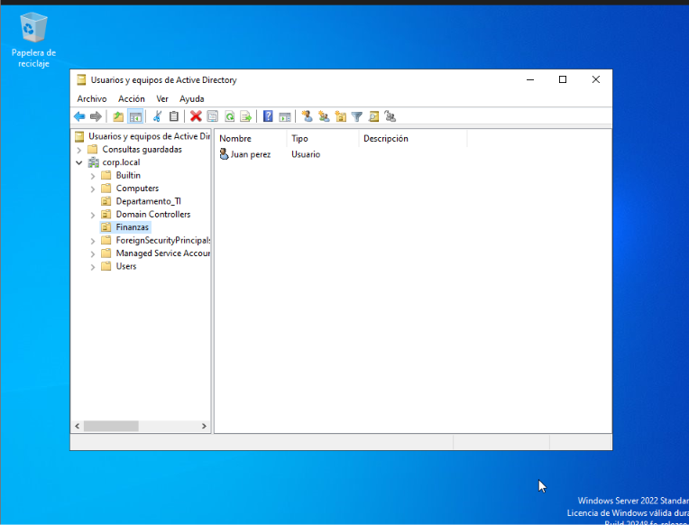
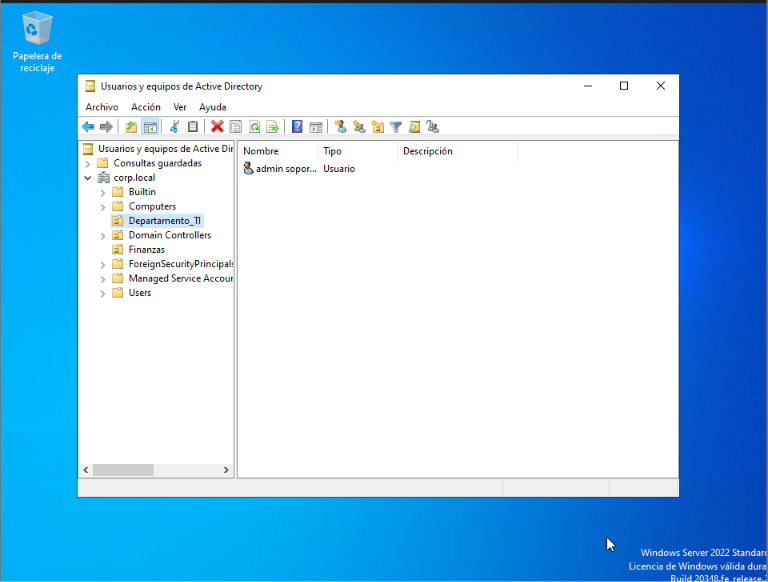
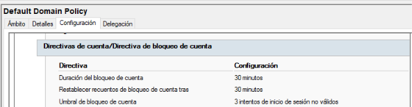
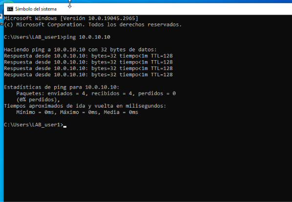
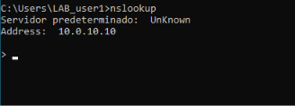

# Lab-ActiveDirectory-SOC
# Laboratorio SOC & Active Directory: Hardening, Simulación de Fuerza Bruta y Análisis Forense

Implementación de una infraestructura corporativa aislada en VirtualBox para aplicar controles de endurecimiento (*Hardening*) en Windows Server 2022, ejecutar una simulación controlada de ataque de fuerza bruta (MITRE ATT&CK **T1110**) desde una estación cliente Windows 10 y realizar la investigación de incidentes mediante el Visor de Eventos (*Event Viewer*).

---

## Arquitectura y Topología de Red

El laboratorio opera sobre una subred NAT privada (`Lab-AD` — `10.0.10.0/24`) con el servidor DHCP de VirtualBox deshabilitado para garantizar direccionamiento estático controlado y resolución DNS interna.

| Hostname | Sistema Operativo | Dirección IP | Máscara / Gateway | DNS | Rol en el Laboratorio |
| :--- | :--- | :--- | :--- | :--- | :--- |
| `WinServer2022-DC` | Windows Server 2022 | `10.0.10.10` | `255.255.255.0` / `10.0.10.1` | `127.0.0.1` | Controlador de Dominio (`corp.local`) y Servidor DNS |
| `DESKTOP-6NENHFM` | Windows 10 Pro | `10.0.10.20` | `255.255.255.0` / `10.0.10.1` | `10.0.10.10` | Estación de trabajo unida al dominio (origen de simulación) |

---

## ⚙️ Fase 1: Gestión de Identidades (IAM) y Mínimo Privilegio

Se estructuró el bosque `corp.local` segmentando los activos por Unidades Organizativas (OUs) y aplicando el **principio de mínimo privilegio** para evitar el uso de la cuenta `Administrator` predeterminada en tareas operativas:

* **OU `Finanzas`:** Contiene la cuenta de usuario estándar `jperez` sin privilegios administrativos.

* **OU `Departamento_TI`:** Contiene la cuenta administrativa dedicada `admin_soporte` integrada en el grupo `Admins. del dominio`.

---

##  Fase 2: Endurecimiento mediante Políticas de Grupo (GPO)

Para mitigar ataques automatizados de adivinación de contraseñas, se modificó la **Default Domain Policy** exigiendo complejidad de claves y configurando la directiva de bloqueo de cuentas:

* **Umbral de bloqueo de cuenta:** `3` intentos de inicio de sesión no válidos.
* **Duración del bloqueo:** `30 minutos`.
* **Restablecer el contador de bloqueo después de:** `30 minutos`.

---

##  Fase 3: Conectividad de Red y Resolución DNS

Antes de incorporar la estación cliente `DESKTOP-6NENHFM` al dominio `corp.local`, se validó la comunicación ICMP hacia el Controlador de Dominio (`10.0.10.10`) y la configuración del servidor DNS interno:

---

## ⚔️ Fase 4: Simulación de Ataque (Red Team — MITRE ATT&CK T1110)

Desde la estación `DESKTOP-6NENHFM` unida a `corp.local`, se simuló un intento de intrusión por fuerza bruta contra la cuenta `CORP\jperez` ingresando credenciales erróneas en **4 ocasiones consecutivas**. Al superar el umbral de 3 intentos definido en la GPO, el sistema denegó el acceso preventivamente.

---

##  Fase 5: Investigación y Triaje SOC (Blue Team)

En el **Visor de Eventos** (`eventvwr.msc`) de `WinServer2022-DC`, se filtró el registro de **Seguridad** por los identificadores críticos de autenticación:

* **Event ID `4625` (An account failed to log on):** Registra cada uno de los intentos fallidos contra `jperez`, detallando el tipo de inicio de sesión y el motivo de fallo de contraseña.
* **Event ID `4740` (A user account was locked out):** Confirma la activación del control defensivo y permite atribuir el origen del incidente mediante el campo **Nombre de equipo del autor de la llamada** (*Caller Computer Name*: `DESKTOP-6NENHFM`).

---

##  Conclusiones y Remediación

1. **Contención efectiva:** La combinación de políticas de bloqueo por GPO limita drásticamente la ventana de exposición frente a ataques de fuerza bruta internos dentro de la misma subred LAN.
2. **Trazabilidad forense:** La correlación entre los eventos `4625` y `4740` permite al analista SOC aislar rápidamente la estación de trabajo comprometida (`DESKTOP-6NENHFM`) para iniciar su contención y análisis de malware.
